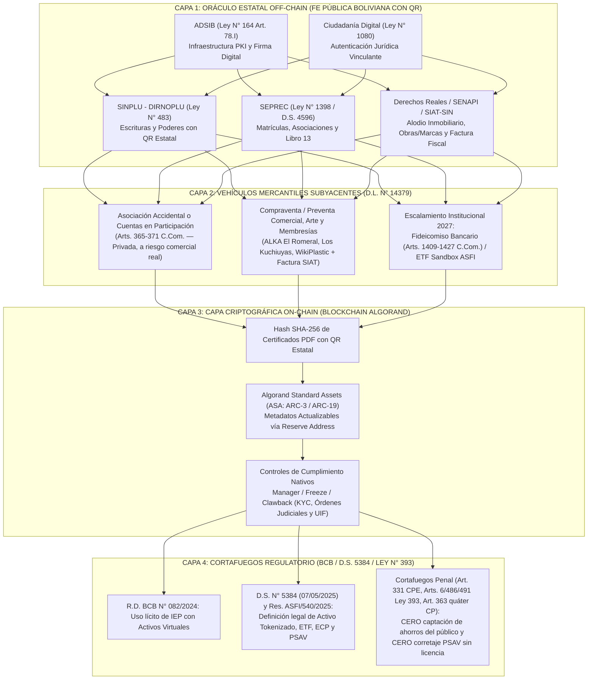

# Arquitectura Jurídica Boliviana de Certificaciones Estatales en Línea y Tokenización de Activos del Mundo Real (RWA) sobre Algorand

**Titular y Arquitecto Estratégico:** Dr. Ignacio Pastor Tapia Vargas & Consorcio Comercial *ELEUSIS ÍCONO* / *PANACEA ÍCONO* (`CASARED S.R.L.`, `EL CENTENIAL S.R.L.`, `BOMGO CLUB S.R.L.`, `SALAR OPULENCELIQOURS S.R.L.`) y Entidad Médica Independiente (`VASER LIPO CENTER S.R.L.`)  
**Jurisdicción Base:** Sucre, Distrito Judicial de Chuquisaca, Estado Plurinacional de Bolivia  
**Marco Normativo Verificado (Actualizado 2025–2026):** `Ley N° 164 (Art. 78.I)`, `Ley N° 1080`, `Ley N° 1398 / D.S. N° 4596 (SEPREC)`, `Ley N° 483 y R.M. N° 57/2020 (SINPLU)`, `Código de Comercio D.L. N° 14379 (Arts. 195, 365–371 y 1409–1427)`, `R.D. BCB N° 082/2024`, `D.S. N° 5384 de 07/05/2025 (ETF, PSAV y Activos Tokenizados)`, `Resolución ASFI/540/2025` y `Ley N° 393`

---

## 1. Síntesis Ejecutiva: El Estado Boliviano como «Oráculo Jurídico-Registral Off-Chain»

El principal desafío de la **Tokenización de Activos del Mundo Real (*Real World Assets* — RWA)** a nivel mundial no es criptográfico, sino **probatorio y registral**: acreditar con certeza legal que el activo físico, comercial, inmobiliario o intelectual que respalda un token en una cadena de bloques (*blockchain*) **existe jurídicamente, pertenece a quien lo declara, cuenta con representación legal vigente y tiene situación transparente de gravámenes**.

En Bolivia, la convergencia de seis infraestructuras públicas electrónicas —**ADSIB** (`Ley N° 164 Art. 78`), **Ciudadanía Digital** (`Ley N° 1080`), **SEPREC** (`Ley N° 1398` y `D.S. N° 4596`), **SINPLU – DIRNOPLU** (`Ley N° 483`), **Derechos Reales – SINAREP** (`Ley de 15/11/1887` y `D.S. N° 27957`) y **SIAT en Línea – SIN** (`Ley N° 843`)— permite que los registros públicos estatales operen como un **Oráculo Jurídico-Registral *Off-Chain* de Fe Pública Directa**, constatable en **3 segundos** por cualquier ciudadano, banco o juez mediante **Códigos QR estatales y Firma Digital**.

Al anclar criptográficamente (mediante huella `SHA-256` y metadatos estándar `ARC-3` / `ARC-19` / `ARC-69`) esas certificaciones estatales dentro de **Algorand Standard Assets (ASA)** sobre la red **Algorand**, se articula una arquitectura de cuatro capas que garantiza seguridad jurídica plena sin invadir jamás el perímetro de intermediación financiera reservado por la **Ley N° 393**:

---

## 2. Capa 1: Funcionamiento Legal de las Certificaciones Electrónicas Estatales en Bolivia

1. **Firma Digital Certificada por ADSIB (`Art. 78.I Ley N° 164` y `D.S. N° 1793`):**
   * **Fuente verificada:** [01_Ley_164_General_Telecomunicaciones_TIC_y_Firma_Digital_Art78.pdf](file:///Users/kuchimac/.gemini/antigravity/scratch/00_PROYECTOS_POR_NUREJ/02_CUENTA_DELATAPIAEMIR_LABORALES_Y_SOCIAL/00_BIBLIOTECA_UNIFICADA_CODIGOS_LEYES_BOLIVIA_Y_RWA_SEPREC/08_TIC_Firma_Digital_QR_Ley164_Ley1080/01_Ley_164_General_Telecomunicaciones_TIC_y_Firma_Digital_Art78.pdf).
   * **Efecto probatorio:** Por mandato expreso del **Artículo 78 de la Ley N° 164** (concordante con los **Arts. 144.II y 149 de la Ley N° 439 CPC**), todo certificado público o contrato privado suscrito mediante **Firma Digital** emitida dentro de la Infraestructura Nacional de Clave Pública por la **ADSIB (`adsib.gob.bo`)** posee **plena validez jurídica y fuerza probatoria idéntica al documento manuscrito**, garantizando autoría, integridad e irrepudiabilidad con sellado de tiempo (*timestamping*).
2. **Ciudadanía Digital (`Ley N° 1080`):**
   * **Fuente verificada:** [02_Ley_1080_Ciudadania_Digital_2018.pdf](file:///Users/kuchimac/.gemini/antigravity/scratch/00_PROYECTOS_POR_NUREJ/02_CUENTA_DELATAPIAEMIR_LABORALES_Y_SOCIAL/00_BIBLIOTECA_UNIFICADA_CODIGOS_LEYES_BOLIVIA_Y_RWA_SEPREC/08_TIC_Firma_Digital_QR_Ley164_Ley1080/02_Ley_1080_Ciudadania_Digital_2018.pdf).
   * **Efecto probatorio (`Arts. 4, 7 y 8`):** Vincula cada actuación y solicitud en portales estatales con la identidad biométrica verificada ante SEGIP del representante legal acreditado (`Sr. Iván Luna Arias` o `Lic. Marvin Gilmar Medrano Chamoso`).
3. **SEPREC (`Ley N° 1398`, `D.S. N° 4596`, `Arts. 25–34 C.Com.` y `R.A./AEMP/N° 055/2022`):**
   * **Fuente verificada:** [02_MDPyEP_Compendio_SEPREC_Ley_1398_y_Desarrollo_Productivo.pdf](file:///Users/kuchimac/.gemini/antigravity/scratch/00_PROYECTOS_POR_NUREJ/02_CUENTA_DELATAPIAEMIR_LABORALES_Y_SOCIAL/00_BIBLIOTECA_UNIFICADA_CODIGOS_LEYES_BOLIVIA_Y_RWA_SEPREC/04_Comercio_SEPREC_Tributario_y_RWA/02_MDPyEP_Compendio_SEPREC_Ley_1398_y_Desarrollo_Productivo.pdf) y ejemplo real [05_Ejemplo_Verificacion_QR_SEPREC_Poder_167_2026_Cert_1135597.pdf](file:///Users/kuchimac/.gemini/antigravity/scratch/00_PROYECTOS_POR_NUREJ/02_CUENTA_DELATAPIAEMIR_LABORALES_Y_SOCIAL/00_BIBLIOTECA_UNIFICADA_CODIGOS_LEYES_BOLIVIA_Y_RWA_SEPREC/08_TIC_Firma_Digital_QR_Ley164_Ley1080/05_Ejemplo_Verificacion_QR_SEPREC_Poder_167_2026_Cert_1135597.pdf).
   * **Función de Oráculo Societario (`tramites.seprec.gob.bo`):** Certifica en línea y con **Código de Validación QR instantáneo** la vigencia anual de Matrícula de Comercio, capital social, régimen de responsabilidad limitada (**Art. 195 C.Com.**), inscripción de Poderes de Administración en el **Libro N° 13** (ej. `T1L64C5410` y `Y0W48U7338` de *CASARED S.R.L.*, `Z9N51H9063` y `N6U51C1600` de *EL CENTENIAL S.R.L.*, `X1M13P2782` de *BOMGO CLUB S.R.L.*, `H5F10P8038` de *SALAR OPULENCELIQOURS S.R.L.*, `GX5X12Y891` de *VASER LIPO CENTER S.R.L.*, así como registros consorciales `901A4BUK1U` de *ELEUSIS ÍCONO* y `7UX1K2IF0A` de *PANACEA ÍCONO*).
4. **SINPLU – DIRNOPLU (`Ley N° 483 del Notariado Plurinacional`, `D.S. N° 2189` y `R.M. N° 57/2020`):**
   * **Fuente verificada:** [03_Ley_483_Notariado_Plurinacional_y_SINPLU_QR.pdf](file:///Users/kuchimac/.gemini/antigravity/scratch/00_PROYECTOS_POR_NUREJ/02_CUENTA_DELATAPIAEMIR_LABORALES_Y_SOCIAL/00_BIBLIOTECA_UNIFICADA_CODIGOS_LEYES_BOLIVIA_Y_RWA_SEPREC/08_TIC_Firma_Digital_QR_Ley164_Ley1080/03_Ley_483_Notariado_Plurinacional_y_SINPLU_QR.pdf) y ejemplo real [04_Ejemplo_Verificacion_QR_SINPLU_DIRNOPLU_Testimonio_168_2026.pdf](file:///Users/kuchimac/.gemini/antigravity/scratch/00_PROYECTOS_POR_NUREJ/02_CUENTA_DELATAPIAEMIR_LABORALES_Y_SOCIAL/00_BIBLIOTECA_UNIFICADA_CODIGOS_LEYES_BOLIVIA_Y_RWA_SEPREC/08_TIC_Firma_Digital_QR_Ley164_Ley1080/04_Ejemplo_Verificacion_QR_SINPLU_DIRNOPLU_Testimonio_168_2026.pdf).
   * **Función de Oráculo Notarial (`sinplu.dirnoplu.gob.bo`):** Todo Testimonio de Escritura Pública o Poder otorgado ante Notaría de Fe Pública lleva impreso un **Código de Seguridad Alfanumérico y QR estatal** que acredita la matriz protocolar del acto constitutivo subyacente.
5. **Derechos Reales (`SINAREP`), Propiedad Intelectual (`SENAPI`) y Facturación Fiscal (`SIAT – SIN`):**
   * **Derechos Reales (`Ley de 15/11/1887`, `Art. 1538 CC` y `D.S. N° 27957`):** La **Información Rápida en Línea** y el **Folio Real Alodial/Treintañal** sobre la Matrícula Computarizada (`1.01.1.99...`) prueban titularidad dominial y estado de gravámenes antes de estructurar cualquier operación inmobiliaria o constructiva (`CASARED S.R.L.`).
   * **SENAPI (`Ley N° 1322 de Derecho de Autor` y `Decisión Andina 486`):** Protege marcas comerciales, software, desarrollos de I+D (`EL CENTENIAL S.R.L.`) y obras artísticas/literarias (`Los Kuchiuyas`, `WikiPlastic`).
   * **SIAT en Línea – SIN (`Ley N° 843`):** Emisión de **Factura Electrónica con CUF y QR** en Bolivianos (Bs.) por toda compraventa o preventa comercial de bienes y servicios reales.

---

## 3. Capa 2: Los Tres Vehículos Jurídicos Mercantiles en el Código de Comercio (`D.L. N° 14379`)

En derecho boliviano riguroso ([01_DL_14379_Codigo_de_Comercio_Bolivia_Texto_Completo.pdf](file:///Users/kuchimac/.gemini/antigravity/scratch/00_PROYECTOS_POR_NUREJ/02_CUENTA_DELATAPIAEMIR_LABORALES_Y_SOCIAL/00_BIBLIOTECA_UNIFICADA_CODIGOS_LEYES_BOLIVIA_Y_RWA_SEPREC/04_Comercio_SEPREC_Tributario_y_RWA/01_DL_14379_Codigo_de_Comercio_Bolivia_Texto_Completo.pdf)), un token digital no reemplaza los requisitos solemnes de transmisión de inmuebles (`Art. 1538 CC`) ni de cuotas de S.R.L. (`Arts. 214–216 C.Com.`), sino que se articula sobre **tres vehículos jurídicos legítimos y diferenciados**:

### 3.1. Vehículo 1 — Participación Comercial Privada Cerrada: Contrato de Asociación Accidental o de Cuentas en Participación (`Arts. 365 al 371 del Código de Comercio`)
> **Precisión normativa obligatoria:** La *Asociación Accidental o de Cuentas en Participación* se regula exactamente en los **Artículos 365 al 371 del Código de Comercio (`D.L. N° 14379`, Libro I, Título III, Capítulo VII)** —ver modelo local en [08_Modelo_Acta_Constitucion_Asociacion_Accidental_Arts_365_371_CCom.pdf](file:///Users/kuchimac/.gemini/antigravity/scratch/00_PROYECTOS_POR_NUREJ/02_CUENTA_DELATAPIAEMIR_LABORALES_Y_SOCIAL/00_BIBLIOTECA_UNIFICADA_CODIGOS_LEYES_BOLIVIA_Y_RWA_SEPREC/04_Comercio_SEPREC_Tributario_y_RWA/08_Modelo_Acta_Constitucion_Asociacion_Accidental_Arts_365_371_CCom.pdf)—. *(Nunca citar por error los Arts. 786–795 C.Com., que regulan contratos distintos del Libro Tercero).*

* **Régimen legal exacto:**
  * **Art. 365 C.Com.:** Dos o más personas toman interés en **una o más operaciones determinadas y transitorias**, a cumplirse mediante aportaciones comunes ejecutadas por el o los **Asociados Gestores** (p. ej. `CASARED S.R.L.` en obras civiles/paisajismo, `EL CENTENIAL S.R.L.` en desarrollos tecnológicos/biotecnológicos o `SALAR OPULENCELIQOURS S.R.L.` en lotes productivos específicos). Carece de personalidad jurídica propia.
  * **Art. 366 C.Com.:** No está sujeta a las formalidades de sociedades permanentes y se acredita por todos los medios de prueba (recomendándose siempre escritura pública o reconocimiento de firmas con QR `SINPLU` y registro consorcial cuando contrate con el Estado/RUPE).
  * **Arts. 367, 368 y 370 C.Com.:** El Asociado Gestor actúa en nombre propio frente a terceros y asume el deber inexcusable de **rendición de cuentas documentada** ante los partícipes (**Art. 370**).
* **Rol del Token en Algorand:** En contratos privados cerrados (*B2B / Joint Venture* entre partes identificadas con *KYC*, **jamás mediante oferta pública masiva**), el token ASA (`Default Frozen = true`, no negociable en mercados abiertos) funciona como **certificado digital nominativo de trazabilidad probatoria (`Art. 78.I Ley N° 164`)** de los aportes comerciales a **riesgo real de ganancias y pérdidas** y de los hitos de rendición de cuentas, **nunca como depósito pasivo ni promesa de interés fijo**.

### 3.2. Vehículo 2 — Consumo Comercial, Preventa de Producto Físico, Arte y Membresía (Tokens Utilitarios y Coleccionables — 100% No Financieros)
* **Estructura operativa (`SALAR OPULENCELIQOURS S.R.L.`, `BOMGO CLUB S.R.L.`, `EL CENTENIAL S.R.L.`, Universo `Los Kuchiuyas` y `WikiPlastic`):**
  * Emisión de **vouchers mercantiles / tokens utilitarios y coleccionables (`ARC-3` / `ARC-19` en Algorand)** que representan:
    1. **Preventa comercial de producto físico real e individualizado** (p. ej., botella numerada de edición limitada *ALKA El Romeral* personalizada según arquetipo/colección *Los Kuchiuyas*, o insumos comerciales de `CASARED S.R.L.`), respaldada por inventario físico auditable y **Factura Electrónica SIAT-SIN (`Ley N° 843`)** emitida en Bolivianos.
    2. **Obra de arte pictórica, literaria o audiovisual autenticada** (`Ley N° 1322 de Derecho de Autor`) y licencias educativas/editoriales (`WikiPlastic`).
    3. **Membresías de acceso a experiencias culturales, gastronómicas y eventos** (`BOMGO CLUB S.R.L.`).
* **Calificación jurídica:** Al constituir **compraventa mercantil de bienes/servicios de consumo real y licenciamiento de propiedad intelectual**, sin expectativa ni promesa de rendimiento financiero pasivo, se encuentra **fuera del perímetro de intermediación financiera y del mercado de valores**.

### 3.3. Vehículo 3 — Escalamiento Institucional Regulado (2027+): Fideicomiso Mercantil (`Arts. 1409–1427 C.Com.`) y Empresas de Tecnología Financiera (`D.S. N° 5384`)
* **Fideicomiso Mercantil (`Arts. 1409 al 1427 C.Com.`):**
  * Conforme al **Art. 1409 del Código de Comercio**, en el fideicomiso típico boliviano el fideicomitente transmite bienes a un **Banco o Entidad Financiera autorizada llamada Fiduciario**, formando un **patrimonio autónomo e inembargable (`Art. 1410 C.Com.`)** inscrito por escritura pública en Derechos Reales o SEPREC (`Art. 1411 C.Com.`).
  * **Regla de oro de cumplimiento:** Ninguna S.R.L. comercial ordinaria puede autodenominarse "Fiduciaria" frente al público sin autorización de ASFI (**Art. 487.II Ley N° 393** y **Art. 4.II D.S. N° 5384**). Mientras se escala hacia un fideicomiso bancario institucional, el aislamiento operativo legítimo se sustenta en la **separación patrimonial estricta de cada S.R.L. (`Art. 195 C.Com.`)** y mandatos especiales inscritos en el **Libro N° 13 de SEPREC** evitando autocontratación (**Art. 471 CC**).
* **Vía Regulatoria para Plataformas Abiertas de Activos Tokenizados (`D.S. N° 5384` y `Res. ASFI/540/2025`):**
  * Si en una fase ulterior se proyecta lanzar una plataforma abierta al público de colocación o intercambio de **Activos Tokenizados (`Art. 3 inc. a D.S. N° 5384`)** para terceros, la vía legal obligatoria en Bolivia es tramitar el ingreso al **Entorno Controlado de Pruebas (*Sandbox Regulatorio — ECP*) y licencia de Empresa de Tecnología Financiera (`ETF`) ante la ASFI**.

---

## 4. Capa 3: Flujo Técnico-Jurídico sobre Algorand («Del Registro Estatal Boliviano al Bloque Criptográfico»)

1. **Vigencia Registral Anual SEPREC con QR:** Emisión del Certificado de Renovación de Matrícula de Comercio y Certificado de Poder en Libro 13 vigentes en `tramites.seprec.gob.bo`.
2. **Instrumentación Notarial `SINPLU` / Firma Digital `ADSIB` del Activo Base:** Protocolización notarial con QR `DIRNOPLU` o contrato electrónico suscrito con Firma Digital `ADSIB` (`Art. 78.I Ley N° 164`) que individualiza el lote comercial, el proyecto asociativo cerrado o la colección intelectual.
3. **Huella Criptográfica (`SHA-256`) y Privacidad de Datos:** Se calcula el *hash* `SHA-256` exacto de los certificados PDF oficiales con QR estatal y del contrato matriz, publicando en metadatos públicos únicamente los códigos QR estatales verificables (`SEPREC` / `SINPLU`) y resguardando los datos personales sensibles fuera de la cadena pública.
4. **Acuñación (*Minting*) en Algorand con Estándares `ARC-3` y `ARC-19`:**
   * **`ARC-19` (Tracto Sucesivo Societario Anual):** Codifica el puntero `CID` de metadatos en la dirección `Reserve` del activo ASA. Cada año, cuando Pamela y los apoderados renuevan la Matrícula de Comercio en SEPREC, una transacción firmada (`acfg`) actualiza la referencia hacia el nuevo certificado anual con QR, dejando en la *blockchain* una **auditoría cronológica inalterable de cumplimiento societario**.
   * **Controles Nativos de Cumplimiento Judicial y UIF:** Configuración de `Default Frozen = true` (lista blanca previa verificación *KYC/AML*), `Freeze` (acatamiento inmediato de medidas precautorias judiciales bajo **Ley N° 439** o **CPP**), `Clawback` (recuperación documentada ante extravío de billetera, sucesión hereditaria o sentencia judicial firme) y `Manager` bajo billetera **Multisig corporativa**.
5. **Portal Público de Transparencia Corporativa:** Cada sitio web empresarial exhibe el botón **«Verificar Vigencia Oficial en SEPREC en 3 Segundos»** junto al enlace de verificación del activo en el explorador público de Algorand.

---

## 5. Capa 4: Marco Regulatorio BCB / D.S. N° 5384 (2024–2026) y Cortafuegos Infranqueable de la Ley N° 393

### 5.1. Normas Específicas Verificadas en Fuentes Oficiales Bolivianas

* **Resolución de Directorio BCB N° 082/2024 (25/06/2024)** — [09_BCB_RD_082_2024_Comunicado_Oficial_Habilitacion_Activos_Virtuales.pdf](file:///Users/kuchimac/.gemini/antigravity/scratch/00_PROYECTOS_POR_NUREJ/02_CUENTA_DELATAPIAEMIR_LABORALES_Y_SOCIAL/00_BIBLIOTECA_UNIFICADA_CODIGOS_LEYES_BOLIVIA_Y_RWA_SEPREC/03_Banca_ASFI_Ley393_VIS_y_Deudas/09_BCB_RD_082_2024_Comunicado_Oficial_Habilitacion_Activos_Virtuales.pdf): Abrogó la R.D. N° 144/2020 y **habilitó el uso de Instrumentos Electrónicos de Pago (IEP)** del sistema financiero nacional para operaciones con Activos Virtuales, recordando que bajo la **Ley N° 1670 de 31/10/1995 (Ley del BCB)** la única moneda de curso legal en Bolivia es el **Boliviano (Bs.)**. *(Complementada en 2026 por las R.D. BCB N° 085/2026 y N° 088/2026 sobre valor referencial diario del dólar).*
* **Decreto Supremo N° 5384 (07/05/2025)** — [07_DS_5384_07_May_2025_Reglamento_Empresas_Tecnologia_Financiera_ETF_PSAV.pdf](file:///Users/kuchimac/.gemini/antigravity/scratch/00_PROYECTOS_POR_NUREJ/02_CUENTA_DELATAPIAEMIR_LABORALES_Y_SOCIAL/00_BIBLIOTECA_UNIFICADA_CODIGOS_LEYES_BOLIVIA_Y_RWA_SEPREC/03_Banca_ASFI_Ley393_VIS_y_Deudas/07_DS_5384_07_May_2025_Reglamento_Empresas_Tecnologia_Financiera_ETF_PSAV.pdf) e Informe Oficial [08_ASFI_2025_Informe_Oficial_ETF_Sandbox_y_Activos_Tokenizados.pdf](file:///Users/kuchimac/.gemini/antigravity/scratch/00_PROYECTOS_POR_NUREJ/02_CUENTA_DELATAPIAEMIR_LABORALES_Y_SOCIAL/00_BIBLIOTECA_UNIFICADA_CODIGOS_LEYES_BOLIVIA_Y_RWA_SEPREC/03_Banca_ASFI_Ley393_VIS_y_Deudas/08_ASFI_2025_Informe_Oficial_ETF_Sandbox_y_Activos_Tokenizados.pdf):
  * **Art. 3 inc. a) Activo Tokenizado:** *"Es la representación digital de un activo real o financiero en una blockchain mediante el uso de tokens."*
  * **Art. 3 inc. f) Proveedor de Servicios de Activos Virtuales (PSAV):** Persona natural o jurídica que **como negocio con fines de lucro realiza operaciones con activos virtuales PARA O EN NOMBRE DE OTRA PERSONA** (intercambio cripto/fiat o cripto/cripto, transferencia, custodia/administración de criptoactivos ajenos o servicios financieros de colocación de un emisor).
  * **Arts. 4 y 5 + Resolución ASFI/540/2025 (03/07/2025):** Toda ETF o PSAV que preste dichos servicios regulados a terceros en el ámbito financiero, mercado de valores o seguros requiere **licencia ASFI o ingreso al Entorno Controlado de Pruebas (ECP / Sandbox)**, prohibiéndose el uso de denominaciones engañosas sin licencia (**Art. 4.II D.S. 5384**).
* **Cortafuegos Penal de la Ley N° 393 (`Art. 331 CPE`, `Arts. 6.I, 486, 487.II y 491 Ley N° 393` y `Art. 363 quáter del Código Penal`):**
  * Fuente verificada: [01_Ley_393_Servicios_Financieros_Texto_Completo_A.pdf](file:///Users/kuchimac/.gemini/antigravity/scratch/00_PROYECTOS_POR_NUREJ/02_CUENTA_DELATAPIAEMIR_LABORALES_Y_SOCIAL/00_BIBLIOTECA_UNIFICADA_CODIGOS_LEYES_BOLIVIA_Y_RWA_SEPREC/03_Banca_ASFI_Ley393_VIS_y_Deudas/01_Ley_393_Servicios_Financieros_Texto_Completo_A.pdf).
  * Queda **absolutamente prohibida** cualquier captación habitual o masiva de dinero o ahorros del público con promesa de devolución de capital más intereses o renta financiera garantizada (delito de **Intermediación Financiera sin Autorización o Licencia, Art. 363 quáter CP**, penado con **5 a 10 años de privación de libertad**, agravada de 7,5 a 15 años si media publicidad masiva), así como toda oferta pública bursátil sin inscripción en el **RMV (`Ley N° 1834`)**.

---

### 5.2. Matriz de Cumplimiento Estricto: Operaciones Lícitas Directas vs. Perímetro Reservado a Licencia ASFI

| Criterio Jurídico | OPERACIÓN LÍCITA DIRECTA SIN LICENCIA FINANCIERA (Ámbito Comercial, Tecnológico y Societario Privado) | OPERACIÓN PROHIBIDA SIN LICENCIA ASFI / SANDBOX ECP (`Ley N° 393`, `Ley N° 1834` y `D.S. N° 5384`) |
| :--- | :--- | :--- |
| **Objeto del Token (ASA en Algorand)** | • **Gemelo digital probatorio** de certificaciones propias con QR (`SEPREC`, `SINPLU`, `DDRR`, `SENAPI`). • **Preventa comercial de producto físico o servicio real propio** (*ALKA El Romeral*, eventos `Bomgo Club`, insumos `Casared`, contenidos `WikiPlastic`) con **Factura SIAT-SIN en Bs.** • **Arte digital/físico y propiedad intelectual** (`Los Kuchiuyas`, `Ley N° 1322`). • **Constancia técnica nominativa y congelada (`Frozen`)** de contrato privado cerrado de **Asociación Accidental (`Arts. 365–371 C.Com.`)** entre asociados empresariales identificados. | • Vender tokens al público prometiendo **intereses fijos, dividendos pasivos garantizados o depósitos remunerados**. • Realizar **oferta pública masiva de valores** representativos de deuda o participación financiera negociable sin registro en el **RMV (`Ley N° 1834`)**. |
| **Custodia e Intermediación** | • Auto-custodia tecnológica de activos propios de cada S.R.L. y emisión directa de sus propios certificados comerciales/intelectuales. | • Operar como *exchange*, casa de cambio cripto/Bs., pasarela financiera o custodio remunerado de activos virtuales **para o en nombre de terceros (`PSAV`, Art. 3 inc. f y Art. 4 D.S. N° 5384)** sin licencia ASFI. |
| **Separación Patrimonial (`Art. 195 C.Com.`)** | • Aislamiento contable, bancario y jurídico absoluto de **`VASER LIPO CENTER S.R.L.` (`Matrícula 349558`, `NIT 318026020`)** como entidad médica independiente, sin cruzar cuentas ni responsabilidades con las 4 S.R.L. comerciales del Consorcio. | • Confusión patrimonial inter-societaria o uso de denominaciones reservadas (*"Banco"*, *"Financiera"*, *"Fondo de Inversión"*, *"Fiduciaria"*, *"ETF Autorizada"*). |
