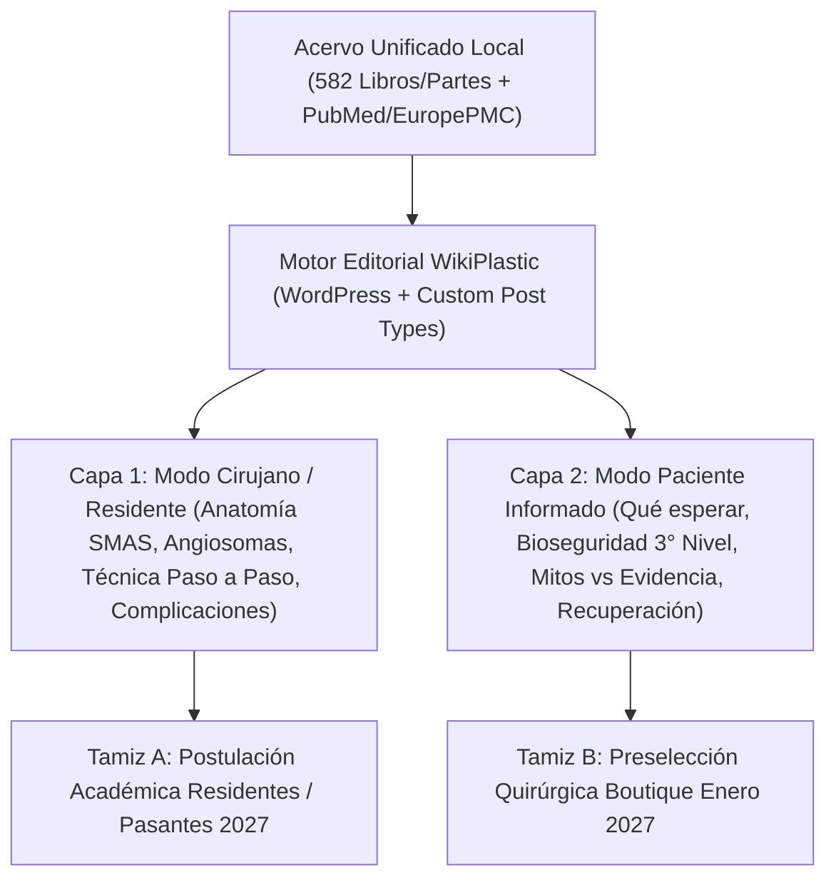

# Plan Maestro: Enciclopedia Quirúrgica `WikiPlastic`, Canal Educativo de Medicina y Cirugía Plástica, y Protocolo de Tamiz Inteligente 2027

**Autoría Académica y Dirección Científica:** Dr. Ignacio Pastor Tapia Vargas (Médico Cirujano Plástico, Estético y Reconstructivo · Mat. Prof. `T-677` · Sucre, Bolivia)  
**Acervo Científico Base Conectado:** [Libros_y_Acervo_Unificado](file:///Users/kuchimac/.gemini/antigravity/scratch/00_PROYECTOS_POR_NUREJ/02_CUENTA_DELATAPIAEMIR_LABORALES_Y_SOCIAL/00_CENTRAL_WORDPRESS_EMPRESAS_WIKIPLASTIC_Y_PODCAST_AVE_FENIX/02_Biblioteca_Medicina_Cirugia_Plastica_y_WikiPlastic/Libros_y_Acervo_Unificado) (**582 enlaces verificados** en 8 ramas científicas).

---

## 1. Diagnóstico y Unificación de Tu Biblioteca Médica y Científica

Tras escanear de extremo a extremo `/Users/kuchimac/Mi unidad/` y `/Users/kuchimac/.gemini/antigravity/scratch/`, localizamos que tus libros de referencia mundial estaban dispersos principalmente entre `Biblioteca_Medica_Global`, `Proyecto_Cirugia_Plastica`, `Cirugia Plastica Organizada`, `Investigacion_Medica_y_Cientifica` y los **490 volúmenes/partes en PDF** resguardados dentro de `MiEspacioColab_Organizado/PDF`.

Todo ese acervo quedó **unificado hoy sin duplicar megabytes** en [Libros_y_Acervo_Unificado/](file:///Users/kuchimac/.gemini/antigravity/scratch/00_PROYECTOS_POR_NUREJ/02_CUENTA_DELATAPIAEMIR_LABORALES_Y_SOCIAL/00_CENTRAL_WORDPRESS_EMPRESAS_WIKIPLASTIC_Y_PODCAST_AVE_FENIX/02_Biblioteca_Medicina_Cirugia_Plastica_y_WikiPlastic/Libros_y_Acervo_Unificado) bajo **8 colecciones maestras** (ver detalle en [00_CATALOGO_UNIFICADO_LIBROS_Y_TRATADOS.md](file:///Users/kuchimac/.gemini/antigravity/scratch/00_PROYECTOS_POR_NUREJ/02_CUENTA_DELATAPIAEMIR_LABORALES_Y_SOCIAL/00_CENTRAL_WORDPRESS_EMPRESAS_WIKIPLASTIC_Y_PODCAST_AVE_FENIX/02_Biblioteca_Medicina_Cirugia_Plastica_y_WikiPlastic/Libros_y_Acervo_Unificado/00_CATALOGO_UNIFICADO_LIBROS_Y_TRATADOS.md)):

1. **Tratados Fundacionales (231 enlaces):** *Grabb & Smith (8ª Ed.)*, *Mathes (8 volúmenes)*, *McCarthy (4 volúmenes)*, *Schwartz (11ª Ed.)* e *Historia de la Cirugía Plástica*.
2. **Colgajos, Microcirugía, Quemados y Heridas Complejas (125 enlaces):** *Grabb's Encyclopedia of Flaps*, *Mathes & Nahai*, *Cirugía Reconstructiva de Quemaduras* y *Atlas de Heridas de Rose Hamm*.
3. **Cirugía Facial, Rinoplastia Estructural, Parálisis Facial y Estética (69 enlaces):** *Toriumi (Structure Rhinoplasty)*, *Tardy*, *Dutton (Órbita)*, *Thomas*, *Escultura Facial 3D*, *Toxina Botulínica y Rellenos* y apuntes propios de *Parálisis Facial*.
4. **Cirugía de la Mano y Miembro Superior (84 enlaces):** *Neligan Vol. 6*, *Chung*, *ASSH Manual* y *Colgajos en Lesiones por Aplastamiento*.
5. **Atlas Anatómicos Quirúrgicos (54 enlaces):** *Netter (6ª Ed. + Surgical Review)*, *McMinn* y *Yokochi (Disección Fotográfica Cadavérica)*.
6. **Biotecnología y Química Verde `ALKA` (4 enlaces):** *Reporte Farmacológico ALKA 2026*, *Plan de Industrialización Fitoquímica* y cuadernos biotecnológicos.
7. **Nanotecnología y Grafeno Aplicado a Biomateriales (5 enlaces):** *Medicina y Nanotecnología Avanzada* y *EcoToken Grafeno*.
8. **Datasets, Multimedia Quirúrgica y Laboratorio Bioestadístico Python (10 carpetas enlazadas):** Incluye [00_LABORATORIO_MEDICO_CIENTIFICO_FORENSE.ipynb](file:///Users/kuchimac/.gemini/antigravity/scratch/Investigacion_Medica_y_Cientifica/00_LABORATORIO_MEDICO_CIENTIFICO_FORENSE.ipynb), `Plastic-surgery-datasets` y ` universidad catolica cirugia 1`.

---

## 2. Arquitectura Editorial y Tecnológica de `WikiPlastic`

### 2.1. Visión y Diferencial Único en Hispanoamérica
**`WikiPlastic`** (`wikiplastic.drtapiavargas.com` o integrada sobre `api.karapanza.in` / `drtapiavargas.com/wikiplastic`) nace como la **primera enciclopedia quirúrgica bilingüe (Español / Inglés) de Cirugía Plástica, Reconstructiva, Contorno Corporal Ultrasónico y Biotecnología Regenerativa** dirigida desde Sucre, Bolivia, que combina el rigor clásico de *Mathes, McCarthy y Grabb & Smith* con **búsqueda semántica asistida por IA y doble nivel de lectura**.

### 2.2. Los 8 Tomos Vivos de `WikiPlastic` (Taxonomía Oficial)
Cada artículo de `WikiPlastic` se publica con una ficha estandarizada de 7 secciones (*1. Definición y Principio Anatómico; 2. Vascularización e Inervación Crítica / Zonas de Peligro; 3. Indicaciones y Contraindicaciones Absolutas; 4. Técnica Quirúrgica Paso a Paso; 5. Cuidados Postoperatorios y Manejo Precoz de Complicaciones; 6. Perlas Clínicas del Dr. Tapia Vargas; 7. Bibliografía Indexada DOI/PMID*):

1. **Tomo I — Principios Básicos, Cicatrización y Manejo Avanzado de Heridas:** Fisiología de la cicatrización, terapia de presión negativa, injertos cutáneos, Z-plastias, expansores tisulares y prevención de necrosis distal por preservación del plexo subdérmico.
2. **Tomo II — Anatomía Quirúrgica Aplicada y Zonas de Peligro Facial (SMAS y Nervio Facial):** Basado en los capítulos ya estructurados en tu carpeta `Proyecto_Cirugia_Plastica` (*Músculos Faciales y SMAS*, *Músculos de la Masticación*, * Ligamentos Retentores* y *Ramas del VII Par*).
3. **Tomo III — Parálisis Facial y Reanimación Dinámica:** Diagnóstico topográfico, escalas clínicas (House-Brackmann / Sunnybrook), transferencias nerviosas, colgajos musculares regionales (temporal/masetero) y microquirúrgicos libres (gracilis).
4. **Tomo IV — Colgajos Locales, Regionales y Microcirugía Reconstructiva:** Escalera y ascensor reconstructivo, clasificación vascular de *Mathes & Nahai* (Tipos I al V), angiosomas y perforantes.
5. **Tomo V — Rinoplastia Estructural, Preservación y Cirugía Estética Cervicofacial:** Anatomía nasal de *Tardy* y soporte estructural de *Toriumi*, blefaroplastia periorbitaria (*Dutton*) y ritidoplastia de plano profundo.
6. **Tomo VI — Lipoescultura Ultrasónica de Alta Definición (VASER), Contorno Corporal y Cirugía Mamaria:** Física de la cavitación ultrasónica selectiva, preservación linfática y vascular, balance hídrico tumescente, límites seguros de lipoaspiración y protocolos antitrombóticos (Caprini).
7. **Tomo VII — Cirugía Reconstructiva de la Mano, Quemados y Trauma Complejo:** Tendones flexores/extensores, cobertura cutánea de mano (*Neligan / Chung*) y reanimación del paciente gran quemado.
8. **Tomo VIII — Fronteras 2027: Biotecnología Botánica (`ALKA`), Nanomateriales de Grafeno e IA Quirúrgica:** Aplicaciones regenerativas, analgesia multimodal ahorradora de opioides, apósitos inteligentes con óxido de grafeno y planificación fotogramétrica 3D.

### 2.3. Flujo Nocturno de Producción de Artículos (Cero Carga Operativa para el Dr. Tapia)
- **Lunes a Viernes (Automático):** Nuestro skill `investigacion-biomedica-bioestadistica` cruza tus capítulos de *Grabb & Smith / Mathes / McCarthy* con revisiones sistemáticas recientes (2022–2026 en PubMed) y redacta **3 entradas completas por semana** en borrador de WordPress.
- **Sábado (15 minutos del Dr. Tapia):** Revisas en tu tablet las 3 entradas, grabas una nota de voz de 60 segundos con tu *"Perla Quirúrgica de Experiencia Propia"* y se publica con tu sello académico.

---

## 3. Parrilla del Canal de YouTube de Medicina, Docencia y Cirugía Plástica (`@DrTapiaVargasMD`)

### 3.1. Dos Formatos Sinérgicos en el Mismo Canal
1. **Cápsulas Magistrales de Pizarra & Atlas (`8 a 12 minutos`, horizontal `16:9`, 1 por semana):** Orientadas a estudiantes de medicina, residentes de cirugía general/plástica y pacientes analíticos que valoran la excelencia científica. Convierten al canal en cátedra abierta de referencia en Bolivia y Latinoamérica.
2. **Reels / YouTube Shorts de Bioseguridad y Educación al Paciente (`45 a 60 segundos`, vertical `9:16`, 3 por semana):** Producidos con tu grabación real o con tu **Gemelo Digital / Avatar Hiperrealista**, derribando mitos peligrosos de la cirugía estética informal y dirigiendo al público hacia el **Tamiz Inteligente 2027**.

### 3.2. Parrilla Inicial Lista de 12 Episodios Fundacionales (Temporada Académica 1)

| Ep. | Línea | Título Magnético y Riguroso | Base en Tu Acervo (`WikiPlastic`) | Llamado a la Acción (CTA) |
|---:|---|---|---|---|
| **01** | Bioseguridad Paciente | **Por qué una Cirugía Plástica Segura exige un Centro de 3° Nivel (Lo que nadie te explica antes de entrar a quirófano)** | Protocolos perioperatorios *Schwartz / Grabb & Smith* | Formulario de Preselección Quirúrgica Enero 2027 (`Tamiz B`) |
| **02** | Cátedra Residentes | **El SMAS y las 5 Zonas de Peligro del Nervio Facial explicadas capa por capa** | `1A_Musculos_Faciales_y_SMAS` + *McMinn / Yokochi* | Descarga de esquema en `WikiPlastic` + `Tamiz A` Residentes |
| **03** | Tecnología VASER | **Física del Ultrasonido Selectivo (VASER) vs. Liposucción Tradicional: Qué pasa realmente bajo la piel** | Física ultrasónica y preservación vascular | Preselección Contorno Corporal Boutique 2027 |
| **04** | Cátedra Residentes | **Clasificación de Mathes & Nahai (Tipos I a V): Cómo elegir el colgajo muscular perfecto sin memorizar a ciegas** | *Mathes & Nahai Vols. 1–8* | Lectura completa en `WikiPlastic` Tomo IV |
| **05** | Educación Paciente | **Anemia, Nutrición y Cicatrización: Cómo preparar tu cuerpo 30 días antes de una cirugía plástica** | Fisiología de cicatrización + *Rose Hamm* | Guía preoperatoria gratuita vía WhatsApp Corporativo |
| **06** | Cátedra Facial | **Rinoplastia Estructural: La arquitectura invisible de la punta y la válvula nasal que permite respirar mejor** | *Toriumi Structure Rhinoplasty Vol. 2* + *Tardy* | Consulta de valoración facial 2027 |
| **07** | Reconstructiva | **Parálisis Facial: Cómo devolvemos la sonrisa simétrica mediante microcirugía y transferencia nerviosa** | `Resumen_Paralisis_Facial_Tratamiento.md` | Canal académico `WikiPlastic` |
| **08** | Educación Paciente | **Trombosis en Cirugía Estética (Escala de Caprini): El protocolo exacto que salva vidas** | Guías internacionales ASPS / *Grabb & Smith* | Tamiz de Seguridad Clínica 2027 |
| **09** | Mano y Trauma | **Anatomía Funcional de la Mano: Las zonas flexoras y por qué un milímetro define el movimiento de un artista o cirujano** | *Neligan Vol. 6* + *Chung* | Cátedra `WikiPlastic` Tomo VII |
| **10** | Biotecnología | **Química Verde Andina y Recuperación Tisular: El futuro de la medicina perioperatoria (`Proyecto ALKA`)** | *Reporte Resumen Farmacológico ALKA 2026* | Portal de Innovación `eleusis-icono.com` |
| **11** | Nanomedicina | **Grafeno y Biomateriales Regenerativos: Hacia los apósitos inteligentes del siglo XXI** | *Medicina y Nanotecnología Avanzada* | Hub Científico `info.universolife.com` |
| **12** | Vocación Médica | **Carta a un Joven Residente de Cirugía Plástica: Arte, proporción áurea, ética y temple en el quirófano** | *A History of Plastic Surgery* + visión humanista propia | Apertura oficial de Plazas de Rotación / Mentoria 2027 (`Tamiz A`) |

---

## 4. Protocolo de Tamiz Inteligente 2027 (`formulario.drtapiavargas.com` + WhatsApp Pamela)

El objetivo del **Tamiz Inteligente 2027** es **proteger el tiempo, la paz mental, la seguridad clínica y la excelencia jurídica/operativa del Dr. Tapia Vargas**: nadie llega a consulta presencial ni a rotación académica sin haber superado previamente un filtro objetivo, educado y documentado.

### Flujo Técnico de Implementación en 3 Capas
1. **Capa Web (`https://formulario.drtapiavargas.com` con WordPress + `Forminator`):** Formulario condicional inteligente con dos rutas iniciales: *[Soy Médico / Estudiante — Postulación Académica WikiPlastic]* o *[Soy Paciente — Preselección Quirúrgica Boutique Enero 2027]*.
2. **Capa de Calificación Automática:** `Forminator` calcula internamente el puntaje de elegibilidad (Semáforo **Verde / Ámbar / Rojo**) sin rechazar de forma brusca, sino dando una respuesta ética y respetuosa acorde a cada perfil.
3. **Capa Humana Ejecutiva (Pamela en WhatsApp `+591 77122210` y `+591 76123237`):** Solo los perfiles en **Semáforo Verde** pasan a agenda de entrevista (académica o preconsulta clínica), con carpeta digital individual y trazabilidad QR desde el minuto cero.

---

### 4.1. TAMIZ A — Filtro para Médicos Residentes, Internos, Pasantes y Fellows (`Programa Académico WikiPlastic 2027`)

#### A. Requisitos de Elegibilidad Base
- Médico titulado, residente activo de Cirugía General / Cirugía Plástica / Otorrinolaringología / Traumatología, o interno de último año con promedio destacado verificable.
- Compromiso absoluto de confidencialidad médica, bioética hipocrática, puntualidad quirúrgica y producción científica en `WikiPlastic`.

#### B. Cuestionario Estructurado del Tamiz Académico (10 Ítems — Puntuación sobre 100 pts)
1. **Identificación Profesional Verificable (15 pts):** Nombre completo, C.I./Pasaporte, Universidad de origen, año de egreso o año de residencia actual, matrícula profesional (si aplica) y ciudad/país.
2. **Modalidad a la que postula para 2027 (Informativo):**
   - *Modalidad 1:* Colaborador Editorial Remoto `WikiPlastic` (revisión bibliográfica e ilustración anatómica).
   - *Modalidad 2:* Rotación Observacional Presencial Corta (*Observership* de 2 a 4 semanas en Sucre, Enero–Marzo 2027).
   - *Modalidad 3:* Pasantía Quirúrgica y de Investigación Clínica (`ALKA-VASER` / Reconstructiva — 3 a 6 meses).
3. **Dominio Idiomático para Lectura Científica (15 pts):** Capacidad real de traducir y sintetizar capítulos en inglés de *Grabb & Smith, Mathes o PubMed* (`Básico: 5 pts` / `Intermedio lectura fluida: 10 pts` / `Avanzado C1+: 15 pts`).
4. **Competencia Anatómica y Quirúrgica Inicial — Mini-Caso Técnico Abierto (25 pts):**
   - *Pregunta filtro:* *"En no más de 150 palabras, explique cuál es la diferencia anatómica entre el plano subcutáneo y el plano sub-SMAS en el tercio medio facial, y qué estructura nerviosa corre mayor peligro sobre el arco cigomático."* *(Filtra instantáneamente vocación real vs. improvisación).*
5. **Habilidades Complementarias de Valor (15 pts):** Fotografía clínica estandarizada, dibujo/ilustración anatómica, bioestadística/Python, edición de video quirúrgico educativo o redacción de artículos científicos.
6. **Ética, Reserva y Respeto al Secreto Médico (20 pts — Excluyente si falla):**
   - *Pregunta situacional:* Aceptación expresa de firmar **Acuerdo de Confidencialidad Clínica, Protección de Datos de Pacientes y Propiedad Intelectual Académica con validación QR** antes de pisar cualquier área clínica (prohibición absoluta de tomar fotos con celular personal sin autorización escrita).
7. **Motivación Personal y Disponibilidad Horaria Real (10 pts):** Breve carta de 10 líneas explicando por qué desea formarse bajo la escuela quirúrgica y humanista del Dr. Tapia Vargas en 2027.

#### C. Regla de Decisión del Tamiz A
- **80–100 pts (Semáforo Verde — Candidato Élite):** Recibe invitación automática para subir su CV y realizar **1 artículo de prueba en `WikiPlastic`**; superado ese artículo, pasa a entrevista breve de 15 minutos.
- **60–79 pts (Semáforo Ámbar — Semillero `WikiPlastic`):** Ingresa primero durante 60 días como colaborador bibliográfico remoto antes de habilitar rotación presencial.
- **< 60 pts o rechazo de cláusula ética (Semáforo Rojo):** Agradecimiento cortés y acceso libre de lectura al canal público de YouTube y `WikiPlastic`.

---

### 4.2. TAMIZ B — Filtro Clínico, Psicológico y Administrativo para Pacientes Preseleccionados (`Retorno Quirúrgico Boutique Enero 2027`)

Diseñado bajo la premisa rectora de 2027: **Operar menos volumen, con máxima seguridad médica, pacientes emocionalmente sanos y agradecidos, expectativas 100% realistas y trazabilidad documental impecable.**

#### A. Cuestionario Pre-Consulta Estructurado en 4 Bloques (Tiempo de llenado: 4 minutos)

1. **Bloque 1 — Datos Personales y Motivo Principal de Consulta:**
   - Nombre completo, edad, ciudad/país de residencia (Sucre, interior de Bolivia o paciente internacional), ocupación y teléfono WhatsApp.
   - Área anatómica de interés principal (*Contorno corporal ultrasónico VASER / Cirugía facial o rinoplastia / Cirugía mamaria / Cirugía reconstructiva o secuelas / Medicina regenerativa*).
   - Ventana deseada para su procedimiento (*Segunda quincena Enero 2027 / Febrero 2027 / Marzo 2027*).

2. **Bloque 2 — Pre-Triaje Médico de Seguridad Perioperatoria (Clasificación ASA Preliminar):**
   - Peso aproximado y estatura (cálculo automático de **IMC**).
   - Antecedentes médicos relevantes: hipertensión arterial, diabetes, alteraciones tiroideas, antecedentes personales o familiares de trombosis/embolia, alergias medicamentosas, anemia conocida o trastornos de coagulación.
   - Consumo actual de tabaco/vapeo, anticoagulantes, antiagregantes, isotretinoína o suplementos herbales.
   - Cirugías previas en la misma zona anatómica (primaria vs. secundaria/revisional).

3. **Bloque 3 — Filtro de Expectativas Realistas y Bienestar Emocional (Prevención de Banderas Rojas):**
   - *Pregunta 1:* *"¿Qué cambio específico y realista espera lograr con este procedimiento y desde hace cuánto tiempo lo ha meditado?"*
   - *Pregunta 2:* *"¿Esta decisión nace exclusivamente de su propio deseo personal o siente presión de una pareja, familiar o entorno externo?"*
   - *Pregunta 3:* *"Toda cirugía requiere disciplina postoperatoria (reposo relativo, fajas, controles puntuales, drenaje linfático y cero tabaco). ¿Cuenta usted con una persona de apoyo y con 10 a 15 días de tranquilidad real para su recuperación?"*
   - *Pregunta 4:* Aceptación previa de que **la indicación quirúrgica final depende exclusivamente del criterio médico presencial y de exámenes laboratoriales/cardiológicos óptimos**, pudiendo el cirujano diferir o declinar cualquier cirugía si priorizar su salud así lo exige.

4. **Bloque 4 — Planificación Logística y Formalidad Administrativa:**
   - Confirmación de conocimiento de que los procedimientos del **Programa Boutique 2027** se realizan exclusivamente en establecimiento hospitalario habilitado de 3° Nivel, con contrato formal de prestación de servicios médicos, presupuesto transparente cerrado y consentimiento informado específico por procedimiento con código QR verificable.

#### B. Matriz de Semáforo Clínico-Administrativo para Pamela (Coordinación Enero 2027)

| Semáforo | Criterios Objetivos del Paciente | Protocolo Exacto de Respuesta de Pamela (`+591 77122210` / `+591 76123237`) |
|---|---|---|
| **🟢 VERDE (Prioridad Boutique Enero 2027)** | Paciente ASA I o ASA II compensado, `IMC < 30` (para contorno estético electivo), no fumador (o dispuesto a suspensión estricta $\ge 4$ semanas), motivación propia madura, apoyo familiar postoperatorio confirmado y disponibilidad para Enero–Febrero 2027. | Agendar **Valoración Médica Personalizada** (presencial en Sucre o teleconsulta inicial si reside en otra ciudad/país), enviar guía de preparación preoperatoria y reservar cupo preferente en agenda quirúrgica de Enero 2027. |
| **🟡 ÁMBAR (Optimización Previa Obligatoria)** | `IMC 30–33`, anemia leve/moderada a corregir, hipertensión/tiroides pendiente de ajuste endocrino/cardiológico, fumador activo o cirugía secundaria compleja que requiere estudios de imagen previos. | Ingresar a **Ruta de Preparación Pre-Quirúrgica de 30–45 días** (nutrición, hematología, suspensión de tabaco, valoración por medicina interna) antes de asignar fecha de quirófano; pasa a cohorte de **Febrero–Marzo 2027**. |
| **🔴 ROJO (Declinación Ética y Protectora)** | Expectativas irreales o signos de trastorno dismórfico corporal, presión externa de terceros, negativa a cumplir controles/protocolos postoperatorios, hostilidad hacia normas hospitalarias o comorbilidad descompensada (ASA III–IV para cirugía estética electiva). | **No agendar cirugía estética electiva.** Enviar respuesta médica cordial y ética priorizando la salud integral del solicitante y recomendando manejo médico/clínico previo correspondiente. |
