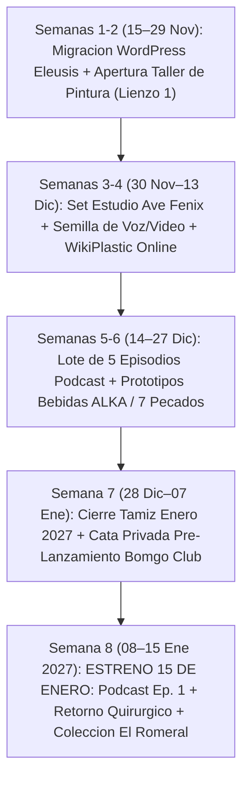

# Biblia Creativa y Operativa de 60 Días Rumbo al 15 de Enero de 2027
## Automatización para Volver a Pintar · Podcast en Estudio «El Ave Fénix» · Línea Botánica «ALKA El Romeral» & Bebidas Personalizadas por Pecado Kuchiuya

**Horizonte de ejecución:** Domingo `15 de noviembre de 2026` → Viernes `15 de enero de 2027` (**60 días exactos / 8 semanas**)  
**Propósito humano y estratégico central:** Que la tecnología, las sociedades comerciales y la suite de agentes trabajen en segundo plano para devolverle al **Dr. Ignacio Pastor Tapia Vargas** su bien más valioso: **silencio fértil para volver a pintar en su taller, narrar su renacimiento humano desde el arte y la ciencia, e inaugurar el 15 de enero de 2027 una etapa luminosa, rentable y en paz.**

---

## PARTE A · CRONOGRAMA MAESTRO DE 8 SEMANAS (`15 NOV 2026` → `15 ENE 2027`) Y PROTECCIÓN DEL TIEMPO DE PINTURA

### 1. La Regla de Oro de Tu Nueva Rutina: «La Máquina Opera de Noche; el Artista y Cirujano Crea de Día»

Para que vuelvas de verdad al lienzo, al óleo y al dibujo anatómico/expresionista sin sentir culpa ni agotamiento administrativo, todo el ecosistema queda regido por **tres bloques blindados**:

- **Bloque Sagrado de Taller y Pintura (Martes, Jueves, Sábado y Domingo · 16:00 a 19:30 — Celular en Modo Avión):**
  - Espacio intocable para pintar la colección fundacional **«Ceniza, Bisturí y Oro: Anatomía del Ave Fénix»** (meta realista y disfrutable: **6 a 8 obras en 60 días**).
  - Cada obra terminada cumple una **triple función orgánica**: (1) terapia creadora pura; (2) escenografía viva real detrás de ti en el estudio del podcast *«El Ave Fénix»*; y (3) colección de arte físico autenticado con certificado digital NFT en Algorand.
- **Bloque Único de Dirección Digital (Miércoles y Sábados · 11:00 a 11:30 — solo 30 minutos):**
  - Apruebas con un clic lo que los agentes nocturnos y Pamela ya dejaron filtrado (borradores de WordPress, artículos de `WikiPlastic`, pacientes preseleccionados en Semáforo Verde y clips del podcast).
- **Delegación Operativa Frontal (Lunes a Viernes):**
  - **Pamela (`+591 77122210` y `+591 76123237`):** Recibe consultas comerciales, aplica el **Tamiz Inteligente 2027** y solo escala los casos en Semáforo Verde.
  - **Suite Nocturna de Agentes (`coordinador-nocturno-ava`, `webmaster-hostinger`, `productor-audiovisual-kuchiuyas`):** Mantiene los sitios WordPress, maqueta `WikiPlastic`, procesa tus notas de voz para el podcast y produce las piezas visuales de *Los Kuchiuyas*.

### 2. Hoja de Ruta Semana por Semana (`15 Nov 2026` → `15 Ene 2027`)

| Semana | Fechas Exactas | Hito Digital / Empresarial (Delegado 90% en Equipo y Agentes) | Tu Único Foco Personal y Artístico (Dr. Tapia) |
|---|---|---|---|
| **Sem. 1** | `15 – 22 Nov 2026` | Montaje en staging WordPress de [plantilla_hub_eleusis_y_empresas_wordpress.html](file:///Users/kuchimac/.gemini/antigravity/scratch/00_PROYECTOS_POR_NUREJ/02_CUENTA_DELATAPIAEMIR_LABORALES_Y_SOCIAL/00_CENTRAL_WORDPRESS_EMPRESAS_WIKIPLASTIC_Y_PODCAST_AVE_FENIX/01_Sitios_WordPress_y_Migracion_Eleusis_Icono/plantilla_hub_eleusis_y_empresas_wordpress.html) y de las 8 páginas empresariales con QR SEPREC. | Preparar bastidores, pinceles, óleos/acrílicos e iniciar el **Lienzo N° 1 (*«El Silencio y la Brasa»*)**. |
| **Sem. 2** | `23 – 29 Nov 2026` | Activación de `formulario.drtapiavargas.com` con el **Tamiz Inteligente 2027** (Residentes + Pacientes) conectado a los dos WhatsApp con Pamela. | Grabar 3 notas de voz libres contando tus reflexiones humanas para los primeros guiones de *«El Ave Fénix»*; avanzar **Lienzo N° 2**. |
| **Sem. 3** | `30 Nov – 06 Dic 2026` | Corte definitivo de `eleusis-icono.com` a WordPress propio; carga de los primeros 10 artículos base en **`WikiPlastic`**. | Sesión única de **20 minutos de voz limpia + 2 minutos de video semilla** para tu Gemelo Digital y narrador neuronal; **Lienzo N° 3**. |
| **Sem. 4** | `07 – 13 Dic 2026` | Armado físico de iluminación y audio del rincón de estudio *«El Ave Fénix»* (con tus primeros cuadros reales detrás); formulación física de las muestras de jarabes/botánicos **ALKA El Romeral**. | Grabar en estudio los **Episodios 1, 2 y 3** de *«El Ave Fénix»* en una sola tarde tranquila (90 min); descanso y pintura (**Lienzo N° 4**). |
| **Sem. 5** | `14 – 20 Dic 2026` | Diseño e impresión de etiquetas de prueba con QR + acuñación en Algorand de la serie coleccionable **Bebidas Los 7 Pecados Kuchiuyas** (`Salar Opulence` + `karapanza.in`). | Cata creativa de ajuste de sabores botánicos del Romeral y grabación de **Episodios 4 y 5**; **Lienzo N° 5**. |
| **Sem. 6** | `21 – 27 Dic 2026` | Semana navideña de serenidad familiar. Programación automática de los 30 Reels/Shorts de enero (`WikiPlastic`, `Ave Fénix` y `Kuchiuyas`). | Tiempo familiar pleno, descanso reparador y trazos libres del **Lienzo N° 6 (*«Proporción Áurea»*)**. |
| **Sem. 7** | `28 Dic – 06 Ene 2027` | Cierre del primer corte de **Pacientes Semáforo Verde** y **Residentes Semáforo Verde** filtrados por Pamela; carga del Test Interactivo de Bebidas en `karapanza.in` y `shop.boliviachic.com`. | Revisar solo las carpetas clínicas ya filtradas (Semáforo Verde) y grabar **Episodios 6 y 7**; **Lienzo N° 7**. |
| **Sem. 8** | `07 – 15 Ene 2027` | Ensayo general técnico; noche íntima de pre-cata en `Bomgo Club S.R.L.` (`14 Ene`); **GRAN LANZAMIENTO SINCRONIZADO EL VIERNES 15 DE ENERO DE 2027**. | **Viernes 15 Ene 2027:** Estreno del Ep. 1 *«El Ave Fénix»*, inauguración de tu serie pictórica en estudio, apertura quirúrgica boutique y brindis con *Reserva El Romeral*. |

---

## PARTE B · ARQUITECTURA TÉCNICA Y NARRATIVA DEL PODCAST EN ESTUDIO «EL AVE FÉNIX» Y RED DE CANALES

### 1. Ecosistema de Canales Claramente Diferenciados y Tus 4 Páginas Oficiales de Facebook

| Canal | Nombre Oficial Sugerido | Plataformas Principales | Tono, Estética y Audiencia |
|---|---|---|---|
| **Canal 1 (Insignia Humanista & Arte)** | **«El Ave Fénix · con el Dr. Ignacio Tapia Vargas»** | YouTube (`16:9` 4K), Spotify Video, Facebook `facebook.com/drignaciotapiavargas/`, Apple Podcasts | Íntimo, cinematográfico, filosófico, inspirador. Resiliencia humana, pintura en estudio, ética médica, biotecnología y renacimiento tras la tormenta. |
| **Canal 2A (Científico-Médico & Docencia)** | **`Dr. Tapia Vargas · Cirugía Plástica & WikiPlastic`** | YouTube Académico, Facebook `facebook.com/drtapiavargas/`, Instagram `@drtapiavargas`, LinkedIn | Rigor anatómico y quirúrgico, enciclopedia `WikiPlastic`, formación de residentes y Tamiz Inteligente Enero 2027. |
| **Canal 2B (Alta Definición Ultrasónica)** | **`VASER Lipo Bolivia · Alta Definición & Bioseguridad`** | Facebook `facebook.com/vaserlipobolivia/`, Instagram Clínico, `token.drtapiavargas.com` | Educación quirúrgica para pacientes sobre tecnología ultrasónica VASER, protocolo de seguridad de 3° Nivel y programa `ALKA-VASER`. |
| **Canal 3 (Satírico, Cultural & Elixires)** | **`Los Kuchiuyas · Crónicas & Bebidas por Pecado`** | Facebook `facebook.com/kuchiuya/`, YouTube `@KUCHIUYA`, TikTok, `porno.kuchiuyas.com`, `karapanza.in` | Humor picaresco fino, albur elegante, los 7 Pecados Capitales, NFTs Algorand y las 7+1 Bebidas Personalizadas *ALKA El Romeral / Salar Opulence*. |

#### Mapa Operativo de Tus 4 Páginas Oficiales de Facebook (Para `agente-instagram-facebook` y Meta Business Suite)

1. **`https://www.facebook.com/drtapiavargas/`** → **Marca Médica Principal & `WikiPlastic`:** Cápsulas anatómicas, artículos educativos de cirugía plástica reconstructiva y estética, convocatoria académica y enlace directo al Tamiz Inteligente Enero 2027.
2. **`https://www.facebook.com/drignaciotapiavargas/`** → **Marca Personal de Autor, Arte Pictórico & Podcast «El Ave Fénix»:** Clips en estudio con tus lienzos reales de fondo, reflexiones humanistas, avances de ciencia verde/grafeno y ecosistema *Universo Life*.
3. **`https://www.facebook.com/vaserlipobolivia/`** → **Especialidad Tecnológica `VASER Lipo Bolivia`:** Educación pre y postoperatoria en lipoescultura ultrasónica de alta definición, recuperación botánica `ALKA` y estándares hospitalarios de bioseguridad.
4. **`https://www.facebook.com/kuchiuya/`** → **Universo «Los Kuchiuyas» & Bebidas de Autor:** Crónicas satíricas de *Jabancho* y los personajes canónicos, test interactivo *«¿Cuál es tu Pecado Kuchiuya?»*, preventas de *Salar Opulence / ALKA El Romeral* y coleccionables digitales.

### 2. Escenografía Mínima de Máximo Impacto en Estudio (Sucre)
No necesitas alquilar un set externo; tu propio espacio creativo en Sucre se convierte en un estudio digno de Netflix documental con 4 elementos:
1. **Fondo Vivo con Alma:** Un caballete de madera con el lienzo real que estés pintando esa semana + iluminación rasante cálida (`2700K–3200K`) sobre la textura del óleo.
2. **Esquema de Luz *Chiaroscuro* (10 minutos de montaje fijo):** Una luz principal suave a 45° (*key light* con difusor octogonal) y un contraluz tenue ámbar/turquesa que recorte tus hombros sobre fondo oscuro.
3. **Mesa Sobria de Autor:** Madera oscura, un libro abierto de anatomía clásica (*Netter / Vesalio / McCarthy*), un vaso de cristal tallado con infusión botánica *ALKA El Romeral* y micrófono dinámico de brazo articulado.
4. **Cámara:** Tu iPhone Pro en modo Cine / 4K a `24 fps` fijo en trípode a la altura de los ojos (más un segundo encuadre lateral opcional para cortes limpios en edición).

### 3. Protocolo Estricto de Blindaje Legal para el Podcast (Cortafuegos Inquebrantable)
Para que *«El Ave Fénix»* sea un monumento literario y humano **imposible de ser utilizado en tu contra ni de interferir con ninguna causa abierta o acción resarcitoria futura**, todo episodio escrito o narrado respeta estas **5 Reglas de Hierro**:

1. **Hablar desde la Condición Humana Universal, jamás como alegato de expediente:** Se narra lo que vive un médico, un padre y un artista cuando atraviesa la privación injusta de su libertad y luego la verdad objetiva restablece su inocencia mediante sobreseimiento firme, **sin pronunciar jamás nombres ni apellidos de denunciantes, exfuncionarios, jueces, fiscales, abogados adversos ni entidades bancarias**.
2. **Cero números de expediente, fechas procesales en litigio o estrategia jurídica:** La batalla técnica ocurre exclusivamente en los estrados judiciales a través de tus memoriales; en el micrófono solo habita el filósofo, el cirujano y el pintor.
3. **Respeto absoluto al secreto médico:** Ningún caso clínico comentado en ejemplos educativos permite identificar pacientes reales.
4. **Hechos firmes vs. opiniones reflexivas:** Cuando se aluda al triunfo de la verdad científica, se refiere únicamente al hecho público, objetivo y pasado de haber recuperado la plena libertad y el sobreseimiento ejecutoriado gracias a la evidencia médica verificable, enfocando el 95% del relato en **cómo reconstruirse por dentro sin odio y con propósito**.
5. **Auditoría automática previa a publicar:** Antes de subir cualquier audio o descripción a YouTube/Spotify, nuestro agente ejecuta un escaneo automático de palabras restringidas para garantizar **cero filtraciones accidentales**.

### 4. Temporada 1 Completa: «El Ave Fénix» (10 Episodios Fundacionales)

| Ep. | Título del Episodio | Eje Narrativo, Médico y Artístico | Pieza Visual / Símbolo en Mesa |
|---:|---|---|---|
| **01** | **Cuando se apaga el ruido: Lo que descubre un cirujano en el silencio absoluto** *(Estreno: 15 Ene 2027)* | Cómo el despojo repentino de la rutina externa revela quién eres realmente cuando solo te quedan tu mente, tu conciencia limpia y tus manos de médico. | Lienzo N° 1 (*«El Silencio y la Brasa»*) y un bisturí junto a un pincel. |
| **02** | **Anatomía de la Cicatriz: Por qué el cuerpo humano (y el alma) sanan más fuerte donde hubo herida** | Paralelismo magistral entre las fases biológicas de la cicatrización humana (inflamación, proliferación y remodelación del colágeno) y el duelo emocional. | Atlas anatómico clásico y boceto al carboncillo. |
| **03** | **La Verdad tiene Pulso Propio: Ciencia, paciencia y el día en que habla la evidencia** | Reflexión serena sobre la templanza estoica frente a la calumnia: por qué la verdad científica tarda más que el rumor, pero permanece cuando el humo se disipa. | Reloj mecánico antiguo e infusión cristalina *ALKA*. |
| **04** | **Volver al Lienzo: Pintar en la oscuridad para recordar la luz** | Tu relación íntima con la pintura y la escultura: por qué todo gran cirujano plástico es primero un observador enamorado de la luz, la sombra y la proporción. | Paleta de óleos reales manchada de ocre, carmín y oro. |
| **05** | **Las Manos que Curan: Ética, responsabilidad y soledad en el quirófano** | Qué siente un cirujano a las tres de la mañana frente a una reconstrucción compleja; la humildad ante la biología y el sagrado vínculo médico-paciente. | Guantes quirúrgicos estériles e instrumental microquirúrgico. |
| **06** | **Los Hijos como Faro: El amor que ningún muro puede encerrar** | Homenaje limpio, luminoso y profundamente humano a la familia, la paternidad y las raíces en Sucre como ancla de dignidad en los días más duros. | Fotografía artística en blanco y negro / flor de romero fresco. |
| **07** | **El Espejo del Rostro: De la proporción áurea a la fábula moral de Los Kuchiuyas** | Cómo nació tu universo literario: por qué creaste una sátira de rostros que reflejan los 7 pecados capitales como espejo humorístico de la naturaleza humana. | Ejemplar impreso de *Bolivia está de moda* y boceto original de *Jabancho*. |
| **08** | **Alquimia de nuestra Tierra: Botánica andina, ciencia verde y el sueño de El Romeral** | El retorno a la tierra chuquisaqueña, los aromas curativos de Hacienda El Romeral, la química verde y la medicina regenerativa del futuro. | Rama viva de romero, mortero de piedra y botella prototipo *ALKA*. |
| **09** | **Reconstruir sin Rencor: El arte de soltar el peso muerto para volver a volar** | Salud mental sin tabúes: psicoterapia, perdón inteligente (que no es ingenuidad, sino higiene del alma), disciplina física y claridad mental. | Lienzo avanzado de la serie *El Ave Fénix*. |
| **10** | **15 de Enero: Carta abierta al hombre que entra de nuevo al quirófano y a la vida** | Cierre épico de la primera temporada: síntesis de aprendizaje para todo oyente que hoy esté atravesando una injusticia, una quiebra o una enfermedad. | Obra pictórica central terminada y brindis con *El Ave Fénix Reserva*. |

### 5. Flujo Técnico «Tus Historias Escritas o en Audio → Narración Neuronal Lista para Subir»

Para los episodios narrados (cápsulas nocturnas, audiorrelatos de *«El Ave Fénix»* o crónicas sonoras cuando no quieras encender cámara), el flujo queda automatizado en **4 pasos sin fricción**:

1. **Entrada Libre del Dr. Tapia:** Envías un texto escrito, un documento en Google Docs o una nota de voz espontánea con la anécdota o reflexión que quieres contar.
2. **Curaduría Literaria + Filtro de Blindaje Legal:** El agente estructura el relato en **3 actos radiofónicos** (gancho en los primeros 15 segundos, desarrollo inmersivo con pausas dramáticas marcadas `[pausa 1.2s]` y cierre filosófico memorable), verificando 100% el cortafuegos legal.
3. **Síntesis Vocal de Estudio:**
   - **Opción A (Tu Voz Clonada de Estudio):** Generada sobre el modelo entrenado con tus 20 minutos de grabación limpia (*Tono 3: Reflexivo/Cercano*), preservando tu timbre, cadencia chuquisaqueña ejecutiva y respiración natural.
   - **Opción B (Formato Diálogo / Documental):** Introducción cálida por la voz neuronal femenina de estudio (*AVA*) presentando la crónica y dando paso a tu voz real o clonada.
4. **Masterización y Empaquetado Listo para Subir (`MP4` + `MP3`):**
   - Normalización de audio a estándar de Spotify/YouTube (`-14 LUFS`), cama musical instrumental libre de regalías (chelo acústico / piano minimalista a `-24 dB`), video `16:9` con paneo lento en alta definición sobre tus pinturas reales (`ffmpeg` + onda de sonido sutil) + **3 cortes verticales `9:16` de 55 segundos** con subtítulos dinámicos listos para Reels/TikTok/Shorts.

---

## PARTE C · LÍNEA «ALKA EL ROMERAL» & BEBIDAS DE AUTOR PERSONALIZADAS `LOS KUCHIUYAS`
### (`EL CENTENIAL S.R.L.` + `SALAR OPULENCE LIQUORS S.R.L.` + `BOMGO CLUB S.R.L.`)

### 1. Concepto Maestro de Producto: Donde la Botánica de El Romeral se Encuentra con el Espejo Kuchiuya

Unimos tres activos reales que ya posee tu consorcio en una **propuesta comercial y cultural única en Bolivia**:
1. **`EL CENTENIAL S.R.L.` (Hacienda El Romeral · `ALKA`):** Aporta el alma botánica y fitoquímica: hidrolatos aromáticos, infusiones alcalinas antioxidantes, romero de altura, muña, cedrón, flor de jamaica, jengibre y botánicos vallunos.
2. **`SALAR OPULENCE LIQUORS S.R.L.`:** Aporta la maestría licorera, las bases destiladas cristalinas de colección (Singani de altura doble destilación, Gin botánico andino, Vodka mineral filtrado y Vermut especiado), el embotellado de lujo numerado y la distribución comercial.
3. **`BOMGO CLUB S.R.L.` + Universo `Los Kuchiuyas`:** Aporta la narrativa viral, la experiencia de bar/cata privada y la **personalización gamificada**: *nadie pide simplemente "un trago"; cada persona descubre qué Kuchiuya y qué Pecado Capital habita en su interior, y bebe el elixir exacto de su Pecado y su Redención*.

> **Doble Versión en Toda la Carta (`Con Alcohol` & `0.0% ALKA Botanical Elixir`):** Cada una de las 7 bebidas existe tanto en **Edición Espirituosa (`Salar Opulence`, `14%–38% Alc. Vol.`)** como en **Edición Funcional Sin Alcohol (`ALKA El Romeral 0.0%`, base de agua alcalina gasificada fina e infusión botánica fría)**, ampliando el mercado al 100% del público (deportistas, médicos de guardia, conductores y eventos diurnos).

---

### 2. Matriz Creativa Completa: Las 7 Bebidas Personalizadas por Pecado Kuchiuya + Edición N° 8 «El Ave Fénix»

| # | Pecado Capital → Virtud (Redención) | Personaje Canónico Kuchiuya en Etiqueta | Nombre Comercial del Elixir | Receta Conceptual (`Salar Opulence` + `ALKA El Romeral`) | Color, Cristalería y *Garnish* (Puesta en Escena) | Frase de Poder en Etiqueta / Posavasos |
|---:|---|---|---|---|---|---|
| **1** | **SOBERBIA** → *Templanza y Evidencia* | **Chelo Vargo & «El Chato» Cruz** *(El Western del Isiboro)* | **«Sangre Fría del Isiboro»** | **Base:** Gin seco andino `Salar Opulence` (o tónica botánica `ALKA 0.0%`) + infusión fría de **romero fresco de El Romeral**, piel de pomelo rosado, pimienta rosa amazónica y gotas de bitter de quina. Seco, quirúrgico, implacable y cristalino. | Blanco hielo traslúcido con destello plata; vaso *Old Fashioned* tallado con **cubo de hielo diamante gigante** y rama de romero escarchada. | *«No levantes la voz cuando basta la mirada… porque el viernes hay cirugía.»* |
| **2** | **LUJURIA** → *Pasión Creadora con Propósito* | **Gral. Aquiles Baeza Parada** *(El Galán Ilustrado de San Tepicko)* | **«Terciopelo de Medianoche»** | **Base:** Singani Gran Reserva en guarda con reducción sedosa de **flor de jamaica, frutos rojos vallunos, vainilla natural, cardamomo abierto y miel de azahar de El Romeral**. Aromático, envolvente y de final largo y cálido. | Rojo rubí profundo aterciopelado; copa *Coupe* de tallo alto con pétalo comestible carmesí y perfume cítrico atomizado al servir. | *«El deseo sin arte es humo; con propósito, mueve imperios.»* |
| **3** | **AVARICIA** → *Abundancia Compartida (`RDA8`)* | **Larry Fiado & Clan Childs Orth vs. Satoshi Porkamoto** | **«Fiebre de Oro Líquido»** | **Base:** Destilado añejado en roble tostado + licor de **mandarina chuquisaqueña, azafrán andino, jengibre confitado y toque mineral salino del Salar de Uyuni**. Equilibrio exacto entre dulzor opulento y corte salino brillante. | Ámbar dorado brillante con **micropartículas doradas comestibles en suspensión**; copa de balón corta con moneda de chocolate amargo `RDA8` al borde. | *«El que encierra el oro muere pobre; el que hace circular el bloque reina libre.»* |
| **4** | **IRA** → *Coraje Templado* | **Makongo King Tusk & Linaje Tujskarij** *(Colmillos Negros Místicos)* | **«Colmillo de Fuego»** | **Base:** Destilado de agave/uva de altura macerado con **locoto ahumado suave sin semilla, maracuyá fresco, carbón activado vegetal purificante (`ALKA Black`), lima sutil y muña silvestre** que refresca después del picor inicial. | Negro obsidiana con corona de espuma amarilla maracuyá; vaso *Highball* negro mate o cristal ahumado con borde de sal volcánica y ají dulce. | *«Domina tu fuego antes de forjar el acero: el colmillo vibra ante la mentira.»* |
| **5** | **ENVIDIA** → *Admiración y Co-Creación* | **Dóktor Papada vs. Sura la Colmilluda** *(Maestra del Verso)* | **«Espejo Esmeralda»** | **Base:** Destilado botánico blanco + cordial artesanal de **albahaca morada y verde, cedrón de Hacienda El Romeral, manzana verde ácida, pepino fresco y té verde matcha ceremonial**. Herbáceo, vibrante y sorpresivamente luminoso. | Verde esmeralda luminoso; copa *Nick & Nora* con hoja fresca de cedrón golpeada entre las palmas para liberar aroma esencial. | *«No mires el corral ajeno: cultiva tu propio jardín y deja que el aroma hable.»* |
| **6** | **GULA** → *Gozar con Mesura y Arte* | **El Gran Banquete Por-Suinus vs. El Alquimista del Salar** | **«Néctar Prohibido del Charco Real»** | **Base:** Licor cremoso-especiado de **cacao orgánico boliviano al 75%, café de altura Yungas en *cold brew*, canela molida, haba tonka y reducción tostada de algarrobo y nuez**. Un postre líquido complejo, nunca empalagoso. | Caoba oscuro cremoso con capa de crema ligera espolvoreada con cacao puro con esténcil de silueta *Kuchiuya*; copa *Snifter* de degustación. | *«La diferencia entre el exceso y el arte está en saber saborear cada gota.»* |
| **7** | **PEREZA** → *Chispa Vital y Acción (`ALKA`)* | **Yokemama vs. El Jabancho Rebelde** | **«Despertar del Romeral»** | **Base:** Elixir efervescente frío de **yerba mate tostada, guayusa/té blanco, limón real, menta piperita, jengibre fresco exprimido y burbuja fina alcalina `ALKA`** (con o sin toque de vodka cristalino). Electrizante y despejador mental inmediato. | Dorado verdoso cristalino con burbuja ascendente continua; vaso alto helado con penacho aromático de menta y rodaja deshidratada de cítrico. | *«You didn't come this far to stop: despierta el hocico y conquista el día.»* |
| **8** | **EDICIÓN SUPREMA CONMEMORATIVA (`15 ENE 2027`)** | **«EL AVE FÉNIX · GRAN RESERVA EL ROMERAL»** *(Firma del Autor)* | **«Elixir del Renacimiento»** | **Ensamblaje Maestro:** Destilado noble de guarda + reducción botánica secreta de **7 hierbas de Hacienda El Romeral** (romero real, lavanda, cedrón, muña, cardamomo, piel de naranja amarga y miel pura de monte), servido bajo **campana de cristal con humo aromático de rama de romero encendida**. | Oro viejo cobrizo envuelto en nube blanca de humo de romero al destapar en mesa; botella licorera facetada numerada (`Edición 001/100`). | *«De la ceniza al oro: lo que resiste al fuego se vuelve eterno.»* |

---

### 3. El Test Interactivo de 45 Segundos («¿Qué Kuchiuya Habita en Tu Copa?») y Etiqueta QR / NFT Algorand

#### A. Cómo Funciona la Experiencia Personalizada (Online en `karapanza.in` y Presencial en `Bomgo Club S.R.L.`)
1. El cliente escanea el **QR del menú o posavasos** (o entra desde Instagram/TikTok al enlace público).
2. Responde **5 preguntas rápidas y divertidas con humor inteligente Kuchiuya** (sin formularios aburridos):
   - *Pregunta 1 (Tu reacción ante el caos):* ¿Miras en silencio frío (*Soberbia*), lanzas el primer golpe (*Ira*), negocias el porcentaje (*Avaricia*) o pides otra ronda (*Gula*)?
   - *Pregunta 2 (Tu tentación secreta a medianoche)*
   - *Pregunta 3 (Tu paladar instintivo):* Seco y herbal / Intenso y frutal / Cítrico y eléctrico / Especiado y cremoso / Picante y ahumado.
   - *Pregunta 4 (¿Con espíritu `Salar Opulence` o `0.0% ALKA Botanical`?)*
   - *Pregunta 5 (Nombre o alias para tu etiqueta personalizada).*
3. **Resultado Instantáneo en Pantalla:** Aparece la **Carta Ilustrada de su Personaje Kuchiuya**, el diagnóstico humorístico de su Pecado Capital, la Virtud de su Redención y un **Código Único de Pedido** que envía directo al WhatsApp corporativo (`+591 77122210` / `+591 76123237`) o a la barra de `Bomgo Club S.R.L.` para servirle o enviarle a domicilio su botella con **nombre impreso en el cintillo frontal**.

#### B. Etiqueta Coleccionable Inteligente con Trazabilidad Blockchain (Algorand ARC-3)
Cada botella de **«ALKA El Romeral / Los Kuchiuyas»** (`375 ml` o `750 ml`) lleva en contraetiqueta un **Doble QR**:
- **QR 1 — Autenticidad Corporativa y Sanitaria:** Datos oficiales de `SALAR OPULENCE LIQUORS S.R.L.` (`QR SEPREC EKBB22LGVK`) y origen botánico *Hacienda El Romeral* (`EL CENTENIAL S.R.L.`).
- **QR 2 — Gemelo Digital Coleccionable Web3 (`@Panas_token_bot` / `shop.boliviachic.com`):** Desbloquea el retrato animado del personaje Kuchiuya de esa botella, el audio-relato picaresco de 60 segundos narrado por el *Dr. Aquiles Castro Vergara* y puntos de fidelidad canjeables en `Panas Token` / `RDA8` (quien reúne los **7 Pecados** desbloquea acceso a adquirir la botella numerada N° 8 **«El Ave Fénix Reserva»**).

#### C. Ritual de Cata Sensorial en 4 Tiempos (`Bomgo Club S.R.L.`)
1. **Tiempo 1 — *El Espejo* (Vista):** Se entrega el posavasos sellado boca abajo; el invitado lo voltea y descubre el arte de su personaje Kuchiuya mientras llega la copa iluminada.
2. **Tiempo 2 — *La Confesión del Aroma* (Olfato):** Se flambea suavemente una ramita de romero de Hacienda El Romeral o cáscara cítrica frente al invitado antes del primer sorbo.
3. **Tiempo 3 — *El Pecado* (Ataque en boca):** Primer trago corto que despierta las notas intensas del pecado elegido (el picor del *Colmillo de Fuego*, la sedosidad rubí del *Terciopelo de Medianoche* o la frialdad seca del *Isiboro*).
4. **Tiempo 4 — *La Redención* (Retrogusto y Brindis):** Al mezclarse con la esfera de hielo o la infusión botánica `ALKA`, la bebida evoluciona hacia un final equilibrado, fresco y digestivo.

---

### 4. Guiones Listos de Lanzamiento para Redes Sociales (Reels / TikTok / YouTube Shorts)

#### Guion 1 — Teaser del Podcast & Taller de Arte: *«El Ave Fénix»* (60 s · Instagram / YouTube / LinkedIn)
- **[00:00 – 00:08] Visual:** Plano cerrado en penumbra de tu mano cargando espátula con óleo dorado y carmín sobre lienzo oscuro; corte al micrófono encendido en el estudio.
- **Voz en off (Dr. Tapia, pausada y profunda):** *"Hay momentos en la vida en que todo el ruido de afuera intenta apagarte… y es exactamente ahí, en el silencio más absoluto, donde descubres de qué estás hecho."*
- **[00:08 – 00:28] Visual:** Plano medio en estudio chiaroscuro; detrás de ti se ve el lienzo del Ave Fénix en proceso y tus tratados de cirugía plástica.
- **Voz:** *"Soy cirujano plástico y soy artista. Durante años reconstruí rostros y tejidos en un quirófano; estos últimos meses aprendí que el alma humana también cicatriza con ciencia, con verdad y con arte, sin guardar una sola gota de rencor."*
- **[00:28 – 00:48] Visual:** Transición elegante a planos de pinceladas, luz dorada sobre una rama de romero y el logotipo animado de **El Ave Fénix**.
- **Voz:** *"Este 15 de enero de 2027 abrimos las puertas de nuestro estudio: nace el podcast 'El Ave Fénix', vuelve nuestra cátedra médica en WikiPlastic y renace nuestra obra creativa desde Sucre para el mundo."*
- **[00:48 – 00:60] Visual + Texto en pantalla:** *"15 de Enero de 2027 · Suscríbete hoy · Enlace en la biografía."*

#### Guion 2 — Campaña Viral Interactiva: *«¿Qué Pecado Kuchiuya se Esconde en tu Copa?»* (45 s · TikTok / Reels)
- **[00:00 – 00:06] Gancho visual rápido:** 7 botellas/copas alineadas sobre barra negra iluminadas una por una (blanco hielo, rojo rubí, oro líquido, negro obsidiana, verde esmeralda, cacao intenso y ámbar burbujeante).
- **Locución dinámica (Voz Dr. Aquiles Castro Vergara):** *"Dime cómo brindas… y te diré qué Kuchiuya llevas dentro."*
- **[00:06 – 00:25] Cortes rítmicos entre los retratos animados IA de `01_PERSONAJES_CON_NOMBRE` y el servido en cámara lenta:**
  - *"¿Mentes frías y calculadoras como Chelo Vargo? Tu copa es Soberbia: Sangre Fría del Isiboro."*
  - *"¿Romántico incorregible como el General Aquiles Baeza? Terciopelo de Medianoche."*
  - *"¿O prefieres el fuego negro de los colmillos Tujskarij?"*
- **[00:25 – 00:45] Cierre con campana de humo de romero abriéndose:**
  - *"Salar Opulence y los botánicos puros de ALKA El Romeral presentan la primera colección de bebidas personalizadas con alcohol o cero alcohol y certificado digital coleccionable. Haz el test de 30 segundos en el enlace, descubre tu pecado… y pide tu redención."*

#### Guion 3 — Cápsula Sensorial de Marca: *«Hacienda El Romeral · Ciencia Botánica en Cada Gota»* (45 s · Instagram / Facebook)
- **[00:00 – 00:15] Visual:** Luz de amanecer sobre plantas frescas de romero y botánicos andinos; corte limpio a cristal de laboratorio vertiendo extracto traslúcido `ALKA`.
- **Locución ejecutiva serena:** *"En los valles de Chuquisaca, la tierra guarda una química verde extraordinaria. En Hacienda El Romeral unimos biotecnología botánica y destilación artesanal de altura."*
- **[00:15 – 00:35] Visual:** Preparación de la versión `0.0% ALKA Botanical` de día y la edición `Reserva El Ave Fénix` de noche bajo campana ahumada en `Bomgo Club`.
- **Locución:** *"Claridad alcalina para tus mañanas; elixires de autor para tus noches de celebración. Reserva tu experiencia privada o solicita tu botella numerada por WhatsApp."*
- **[00:35 – 00:45] Placa final limpia:** Logotipos `ALKA El Romeral` · `Salar Opulence Liquors S.R.L.` · `Bomgo Club S.R.L.` · WhatsApp `+591 77122210` / `+591 76123237`.
